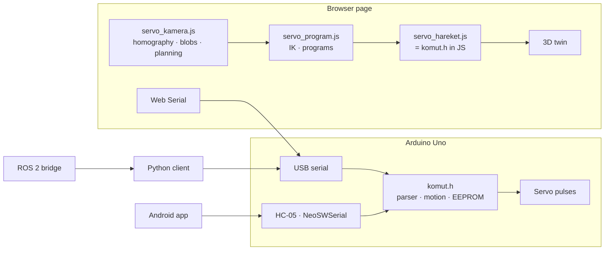

# Servo Robot Arm: firmware, simulation, vision and tooling

A 5-DOF + gripper desktop robot arm (3 × MG996R, 3 × SG90, Arduino Uno, HC-05), in the style of
[How To Mechatronics' DIY Arduino Robot Arm](https://howtomechatronics.com/tutorials/arduino/diy-arduino-robot-arm-with-smartphone-control/).
Everything was written for this project: our own printable parts (parametric CadQuery model sized to MG996R / SG90,
solid-body collision sweep, STEP/STL, [cad/](cad/README.md)), firmware, a browser-based digital twin with inverse
kinematics and colour-sorting vision, a Python client, a URDF and the test suite.

> Status: software complete and verified in simulation; hardware not yet assembled (parts and prints pending).
> Detailed Turkish documentation: [README.md](README.md).

| Simulation and program editor | Camera tab: virtual camera, detection, auto-calibration points |
|---|---|
|  |  |

## What it does

- **Firmware** (`arduino/`): compatible with the original Android app's protocol, with these additions:
  - A parser that handles concatenated and fragmented Bluetooth messages.
  - Synchronised, acceleration-limited motion: every joint starts and stops together.
  - 0.1° servo resolution via microsecond pulses.
  - 50 poses stored in EEPROM.
  - USB telemetry.
  - NeoSWSerial instead of SoftwareSerial, so Bluetooth reception does not block the Servo timer interrupt and the servos do not jitter.
- **Digital twin** (`sim/`): a single HTML page.
  - Its motion engine is bit-identical to the C++ firmware (verified on 75,000 random steps).
  - Over Web Serial it drives the real arm and mirrors its pose.
  - Closed-form 5-DOF IK, Cartesian jogging, a pick-and-place program editor with straight-line moves, and upload to EEPROM.
  - Per-joint calibration (offset, direction), reachability map and static torque check.
- **Vision**: laptop webcam or a virtual camera rendered from the same scene.
  - **Table plane:** a homography from 4 clicks, or **automatic calibration with the arm itself** (a coloured ball on the gripper is moved to 8 known points).
  - **Camera pose:** estimated from the single homography (Zhang, square pixels, centred principal point).
  - **Base footprint of tall objects:** a pixel belongs to the base if, pushed away from the camera as if it were at the object's height, it is still inside the blob. This removes the oblique-view parallax: 13.4 mm → 0.34 mm error for 20 mm cubes.
  - **Cube yaw:** from the 4th angular moment, since second moments are isotropic for a square.
  - **Grasp planning:** wrist rotation, and pick/place tool angles searched separately so the arm reaches near and far objects.
  - **Grasp verification** with retry.
- **Python client** (`pc/kol_istemci.py`): same protocol, IK, straight-line moves. Tested against the real firmware code compiled as a DLL and used as a fake serial port with virtual time.
- **ROS 2** (`ros2/`, not yet run on ROS): URDF generated from the model (forward kinematics equal to the model within 1e-16 m), RViz launch file and a `/joint_states` bridge.

## Architecture



## Verified

| Suite | What it checks | Result |
|---|---|---|
| `arduino/test/test_komut.cpp` | parser, motion limits, synchronised arrival, EEPROM persistence (`-O0` / `-O2`) | ✅ |
| `sim/test_hareket.py` | JS motion engine vs C++ firmware, 25 random scenarios | bit-identical |
| `sim/test_program.js` (11) | IK targets < 1 mm, straight line < 1 mm deviation, upload, calibration | ✅ |
| `sim/test_kamera.js` (16) | ray-traced synthetic images: homography, camera pose, base finding, cube yaw, auto-calibration, end-to-end grasp | ✅ |
| `sim/test_urdf.py`, `sim/test_servo_model.py` | URDF vs model FK, JS vs Python kinematics | ✅ |
| `pc/test_kol_istemci.py` (12) | Python client against the firmware DLL | ✅ |
| PlatformIO | Arduino Uno build: Flash 38.1 %, RAM 44.7 % | ✅ |

```bash
python testleri_calistir.py      # all suites (needs Node.js and g++/clang++ or `pip install ziglang`)
pio run -d arduino               # firmware build
```

Measured in the virtual scene (oblique "laptop" camera): with arm-based auto-calibration, cube positions were found within
0.2–0.4 mm. Sorting 4 reachable cubes took ~40 s; each cube was placed within 0.6–0.8 mm of its bin, and the unreachable one was reported.

## Not yet verified

The arm has not been built. Link lengths and part masses now come from our own CAD design (shoulder height 96,
upper arm 120, forearm 100, wrist to grip point 95 mm); a few servo dimensions (ear hole spacing, horn height) are
still estimates to be measured before printing. Print tolerances, real webcam colour segmentation, the NeoSWSerial jitter fix and the ROS 2 package are untested on
hardware.

## Credits

The arm concept follows How To Mechatronics' design; the printed parts in `cad/` are an independent design (their STL
files are not used or included). The firmware is an independent implementation compatible with their Android app's command format.
