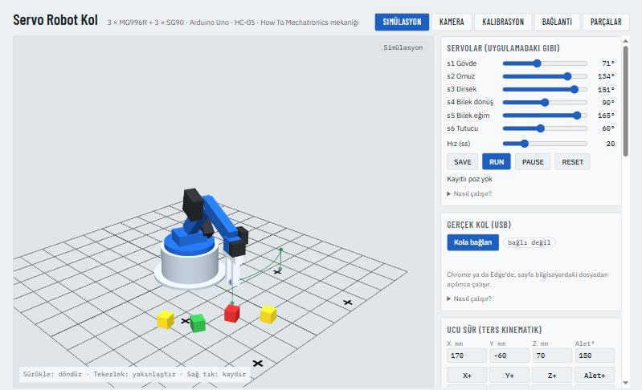
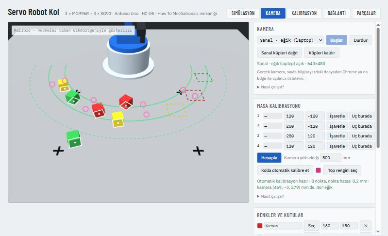

# Servo Robot Kol (How To Mechatronics tasarımı)

> English summary: [README.en.md](README.en.md) · Bütün testler: `python testleri_calistir.py` · Firmware derleme: `pio run -d arduino`

| Simülasyon ve program | Kamera: sanal kamera, tespit, otomatik kalibrasyon |
|---|---|
|  |  |

**Durum (2026-10-20):** 🟡 Kod, bağlantı şeması, parça listesi, simülasyon, bilgisayardan (sayfa + Python) kontrol, kamerayla renge göre ayırma ve URDF hazır → STL'lerin satın alınması, baskı, montaj
**Simülasyon:** [Servo Robot Kol](https://claude.ai/artifact/D32LwbD25vqgeYUP6Asrh4) (3B kol, uygulama kaydırıcıları, SAVE/RUN, ters kinematik, tork, bağlantı şeması, parça listesi). Gerçek kola bağlanmak için aynı sayfa yerelden açılır: [§3](#3-bilgisayardan-kontrol-dijital-ikiz)

Masaüstü, 5 eksen + tutucu, 3D baskı gövdeli Arduino kolu. Mekanik How To Mechatronics'in "DIY Arduino Robot Arm with Smartphone Control" projesinden. Arduino kodu bu proje için ayrıca yazıldı; orijinal telefon uygulamasının komutlarını anlıyor.


---

## 1. Parçalar (~1,9–3,2 bin TL)

| Parça | Adet | Birim (KDV dahil) | Nereden |
|---|---|---|---|
| MG996R servo, 180°, metal dişli (gövde, omuz, dirsek) | 3 | 162,80 TL | [Komponentci](https://www.komponentci.net/tower-pro-mg996-mg996r-rc-servo-motor-180-pmu4034) · [Robot Sepeti](https://www.robotsepeti.com/tower-pro-mg996-r-servo-motor-180) 182,65 |
| SG90 mikro servo (bilek dönüş, bilek eğim, tutucu) | 3 | 104,61 TL | [Direnç.net](https://www.direnc.net/sg90-9g-servo-motor-1) |
| Arduino Uno R3 klon | 1 | 261,36 TL | [Robocombo](https://www.robocombo.com/Arduino-UNO-R3-Klon-Orijinal-USB-Cip-USB-Kablo-Hediye) · [Robolink](https://www.robolinkmarket.com/arduino-uno-r3-klon) 472,50 |
| HC-05 Bluetooth modülü | 1 | 225,51 TL | [Robotistan](https://www.robotistan.com/hc05-serial-port-bluetooth-module) |
| 5 V 5 A metal kasa adaptör (servolar için) | 1 | 214,02 TL | [Robocombo](https://www.robocombo.com/5V-5A-SMPS-Metal-Kasali-ACDC-Adaptor-MS-25-5,PR-499.html) |
| DC jak, jumper kablo, mini breadboard, 1 kΩ + 2 kΩ direnç, 1000 µF kondansatör | – | ~150 TL **(tahmin)** | |
| M3/M4 cıvata-somun (tutucu), lastik bant (omuz) | – | ~60 TL **(tahmin)** | |
| 3D model dosyaları | 1 | 2,85 $ ≈ 141 TL | [Cults3D – HowToMechatronics](https://cults3d.com/en/3d-model/various/arduino-based-robot-arm-howtomechatronics) |
| 3D baskı, ~230 g | – | 0,25–6 TL/g → 58–1.380 TL | Online hizmet ya da İzmir'de bir atölye |

230 g baskı miktarı orijinal sayfadaki bir kullanıcı yorumundan; STL'ler gelince `stl/stl_olc.py` gerçek değeri verecek. Fiyatlar 2026-10-19 arama anından, stok değişebilir.

Servo verileri: MG996R 9,4 kgf·cm @4,8 V, 55 g, durma akımı 2,5 A ([TowerPro veri sayfası](https://courses.ece.cornell.edu/ece5990/ECE5725_Spring2020_Projects/May_15_Demo/Smart%20Lock/W_pp445_yl656/datasheet/MG996R_Tower-Pro.pdf)). SG90 1,2–1,8 kgf·cm, 9 g ([veri sayfası](https://bit.nkust.edu.tw/~csshieh/teach/111A/mc/datasheet/SG90.pdf); yeni listelerde 1,2, muhafazakâr değer bu).

---

## 2. Adımlar

1. **STL'leri satın al:** Cults3D sayfası, 2,85 $. Ödeme ve hesap senin.
   - Lisans "CULTS PU" görünüyor; kişisel kullanım lisansı olduğunu tahmin ediyorum, sayfada teyit et. Dosyaları başkasıyla paylaşma.
   - ZIP'i `stl/` klasörüne aç ve şunu çalıştır:
     ```bash
     python stl/stl_olc.py --tl-g 2
     ```
     Her parçanın boyutu, toplam baskı kütlesi ve maliyeti çıkar. Gönderirsen gerçek ölçüleri simülasyona işlerim.
2. **Bastır:** PLA yeterli, %20–30 dolgu, 3 duvar. Hizmete STL'leri ve bu ayarları ver.
3. **Kablola:** Simülasyon sayfasındaki "Bağlantı şeması" sekmesi. Kısaca:

   | Arduino | Bağlantı |
   |---|---|
   | D5 / D6 / D7 | Gövde / omuz / dirsek (MG996R) sinyal |
   | D8 / D9 / D10 | Bilek dönüş / bilek eğim / tutucu (SG90) sinyal |
   | D3 | HC-05 TX |
   | D4 | HC-05 RX, **1 kΩ / 2 kΩ bölücüyle** (RX 3,3 V) |
   | 5V, GND | HC-05 VCC, GND |
   | GND | 5 V adaptörün GND'si (**ortak toprak şart**) |

   Servoların + ve − uçları 5 V adaptörden beslenir, **Arduino'nun 5 V pininden değil**. MG996R tek başına 2,5 A çekebilir. Servo rayına 1000 µF kondansatör, ani akım çekilişlerinde Arduino'nun resetlenmesini önler (orijinalde yok, öneri).
4. **Kodu yükle:**
   - Arduino IDE'de `arduino/kol_servo/kol_servo.ino` dosyasını aç, kart olarak "Arduino Uno" seç ve yükle.
   - Servo kütüphanesi IDE'de hazır gelir. **NeoSWSerial**'ı bir kez kur: Araçlar → Kütüphaneleri Yönet → "NeoSWSerial" (SlashDevin). Kuramazsan `kol_servo.ino`'da `NEOSWSERIAL_KULLAN`'ı 0 yap; yerleşik SoftwareSerial kullanılır.
   - Klon kart CH340 çipliyse sürücüsü gerekebilir.
5. **İlk açılış:**
   - **Servo kollarını takmadan önce servoları ortala.** Kodu yükle, servoları kablola, sayfayı USB ile bağla. Kalibrasyon sekmesi → "Tüm servoları 90°'ye getir"e bas (sayfa yoksa seri monitöre `a1900 a2900 a3900 a4900 a5900 a6900 GO`). Sonra kolları referans konumunda tak: gövde ileri, üst kol dik, ön kol düz, bilek düz, tutucu yarı açık. Böylece her eklem iki yöne eşit döner, sonraki ince ayar birkaç dereceyle kalır.
   - Servolar açılışta kayıtlı ev pozuna birden gider. Kolu elle o poza yakın tut.
   - Seri monitörü 115200'de aç ve `?` yaz: `@ 900 1000 800 900 900 600 | poz 0 | oynuyor 0 | ss 20` gibi bir satır gelir (açılar onda bir derece).
   - Seri monitörden `s290` gibi komutlarla her servoyu dene.
6. **Telefon:**
   - How To Mechatronics'in Android uygulamasını onların sayfasından indir ve HC-05 ile eşleş (PIN genelde 1234).
   - Kaydırıcılar ve SAVE / RUN / PAUSE / RESET doğrudan çalışır.
   - Bağlanıp komutlar işlenmiyorsa kodda `HC05_BAUD` değerini 9600 yap. Orijinal 38400 kullanıyor, modüllerin fabrika ayarı genelde 9600.
   - **Neden NeoSWSerial:** Yerleşik SoftwareSerial her karakteri alırken kesmeleri kapatıyor. Servo kütüphanesi darbe zamanlaması için kesmelere dayandığından, telefon kaydırıcıları veri akıtırken servolar ara sıra seğiriyor; bu bilinen bir sorun ([Arduino forumu](https://forum.arduino.cc/t/softwareserial-and-servo-conflict/321859), [PJRC Servo belgesi](https://pjrc.com/teensy/td_libs_Servo.html)). NeoSWSerial kesmeleri karakter boyunca kapatmıyor ve 9600/19200/38400'ü destekliyor ([kütüphane sayfası](https://github.com/SlashDevin/NeoSWSerial)). Kaynağına baktım: Uno'da yalnız Timer0 sayacını okuyor ve RX pini için pin değişim kesmesini kullanıyor. Servo Timer1'i kullandığı için çakışma yok. Seğirmenin gerçekten kaybolduğu donanımda görülecek.
7. **Ayar (`kol_servo.ino` başı):**
   - `EV`: açılış pozu.
   - `MIN_ACI` / `MAX_ACI`: her servonun güvenli sınırı. Özellikle **tutucu**: parmaklar kapanınca servo zorlanmasın, yoksa ısınır.
   - Omuzdaki lastik bant omuz servosunun yükünü azaltır.
   - `komut.h` başındaki `A_MAX` (ivme, 200°/s², tahmin): kol kalkışta ya da duruşta sarsılıyor veya titriyorsa düşür.
8. **Kalibrasyon (simülasyon sayfası → Kalibrasyon sekmesi):** Kol kurulunca, ters kinematik ve program kullanılmadan **önce** yapılır.
   - Servo kolları dişliye tam 90°'de oturmaz. Her eklemde birkaç derece kayma, uçta santimlerce hata demektir.
   - Her eklemi kaydırıcı ya da ±0,5 / ±5 düğmeleriyle referans konumuna getir ve **Burası**'ya bas: ofset kaydedilir.
   - Referanslar: gövde ileri, üst kol dik yukarı, ön kol üst kolla düz, bilek ön kolla düz, tutucu çeneleri yana açılıyor.
   - +5'e basınca eklem tablodaki yöne gitmiyorsa yönü −1 yap (servo ters takılmış).
   - **Referans pozuna git** ile kontrol et: kol dik yukarı, dümdüz durmalı.
   - Tutucu için "açık" ve "kapalı" açılarını da buradan kaydet; program bunları kullanır.
   - Değerler tarayıcıda saklanır. Arduino kodu değişmez, çünkü ters kinematik bilgisayarda hesaplanıyor.

---

## 3. Bilgisayardan kontrol (dijital ikiz)

Simülasyon sayfası USB'den kola bağlanır. Bağlıyken sayfadaki kaydırıcılar, SAVE/RUN ve ters kinematik "Git" gerçek kolu sürer. 3B model de kolun bildirdiği gerçek konumu çizer, telefondan oynatılsa bile ekrandaki kol onu takip eder.

1. Arduino'yu USB ile bağla. Arduino IDE'nin seri monitörü açıksa kapat (port tek programa açılır).
2. `sim/servo-kol.html` dosyasını **Chrome ya da Edge** ile aç (dosyaya çift tıkla ya da tarayıcıya sürükle).
   - claude.ai'deki artifact sayfası başka bir sayfanın içinde açıldığı için tarayıcı ona USB izni vermez; orada düğme pasif kalır.
3. "Kola bağlan"a bas ve Arduino'nun portunu seç. Port açılınca Arduino yeniden başlar ve kol açılış pozuna gider; ~2 sn sonra "bağlı" yazar.

Arka planda sayfa saniyede 25 kez `?` sorar ve `@ …` satırını okur (~1,1 kB/s). Komutlar, telefon uygulamasıyla aynı metin komutlarıdır. "Git" ise `a1…a5` + `GO` ile 0,1° çözünürlükte gönderilir.

### Ucu sürme ve program

Bu kısımlar hem simülasyonda hem bağlı kolda aynı çalışır.

- **Ucu sür:**
  - X+/X−, Y±, Z± ve Alet± düğmeleri ya da klavyedeki oklar ve Page Up/Down, kolun ucunu seçilen adım kadar (2–20 mm ya da °) götürür.
  - Hesap kolun hedef pozundan yapılır, bu yüzden hareket bitmeden basılan adımlar da birikir.
  - Açılış pozunda kol dik durduğu için oradan sürülemez. Önce bir çalışma noktasına "Git".
  - **Erişim alanını göster:** Kutulardaki Z ve alet açısında ucun gidebildiği yerleri yeşil noktalarla çizer ve yatay uzaklık aralığını yazar.
- **Program:** "Git (X, Y, Z, alet)", "Tutucu (°)" ve "Bekle (ms)" adımlarından oluşan bir liste.
  - "+ Şu anki uç" kolun o anki ucunu ekler.
  - **Al-bırak şablonu** 11 adım üretir: aç, üstüne gel, in, kapa, kalk, bırakma noktasının üstüne git, in, aç, kalk. İniş ve kalkışlar "düz"dür.
  - **"düz" işaretli adım:** Uç önceki noktadan düz çizgide gider (5 mm'lik ara noktalarla; kol ara noktalarda durmaz, eklemler hedefe 1,5° kalınca sıradakine geçer).
    - İşaretsiz adımda eklemler birlikte döner ve uç bir yay çizer.
    - Simülasyonda 149 mm'lik çapraz yolda düz gidiş 0,85 mm saptı (2,5 sn). Aynı yolu eklemle gitmek 18,9 mm saptı (1,0 sn). 40 mm düşey inişte sapma 0,2 mm.
    - Düz yolun ortası erişim dışından geçiyorsa (ör. kola çok yakın) adım kırmızı olur.
  - Adımlar yerinde düzenlenir, sırası değiştirilir, JSON olarak dışa ya da içe aktarılır. Program tarayıcıda saklanır.
  - Erişilemeyen adım kırmızı görünür, program çalışmaz.
  - 3B görünümdeki yeşil çizgi, ucun **gerçekten izleyeceği yol**dur. Senkron hareket eklem uzayında düz bir çizgidir; yol bundan hesaplanır ve simülasyondaki hareketle 0,08 mm içinde örtüşür.
- **Çalıştır:** Her adımda kolun hedefe varmasını bekler (15 sn zaman aşımı). Döngü seçilebilir, Durdur kolu yavaşlatarak durdurur.
  - Simülasyonda örnek al-bırak ~10 sn sürüyor.
- **Kola yükle:** Programı kolun EEPROM'una yazar. Kol sonra bilgisayarsız, RUN ile (sayfadan ya da telefondan) döngüde oynatır.
  - Koldaki eski kayıtları sildiği için iki basış ister.
  - Her poz `a1…a6` + `PUT` ile gönderilir ve Arduino'nun "Poz kaydedildi" cevabı beklenir; EEPROM yazımı sürerken seri tampon taşmasın diye.
  - `PUT` hedefi kolu kıpırdatmadan kaydeder.
  - "Bekle" adımları kolda saklanamaz.
  - Düz yolların ara noktaları yüklenmez (50 poz sınırını doldururdu). Kolda bu hareketler düz değil, eklemlerle birlikte yapılır.

### Kamera ile renge göre ayırma (Kamera sekmesi)

Laptop kamerası ya da USB webcam masayı görür; kol renkli nesneleri bulur, alır ve rengine göre kutusuna bırakır.

**Kaynak:**
- **Gerçek kamera:** Sayfa bilgisayarda Chrome ya da Edge ile doğrudan açılınca listelenir; claude.ai bağlantısında tarayıcı izin vermez.
- **Sanal kamera:** Simülasyon sahnesini eğik (laptop gibi) ya da tepeden gösterir. Sanal küpler dağıtılır, kol onları gerçekten tutup taşır. Böylece bütün akış donanımsız denenebilir.

**Kurulum:**
1. **Kamerayı yerleştir.** Laptop, kolun karşısına konup ekranı geriye yatırılarak kamera masaya eğik baktırılabilir. USB webcam bir sehpaya ya da rafa tutturulabilir. Önemli olan, kol çalışırken kameranın kıpırdamaması; kıpırdarsa kalibrasyon yenilenir.
2. **Masa kalibrasyonu:** Masaya dört işaret koy (bant, kâğıt köşesi). Her birini görüntüde işaretle ve masadaki yerini yaz (mm, taban merkezinden; X ileri, Y sola). Ölçmek yerine kolun ucunu işarete değdirip "Uç burada" da diyebilirsin.
   - Eğik bakan kameranın konumu ve odak uzaklığı bu dört noktadan kendiliğinden bulunur. Tek homografiden kamera kalibrasyonu yapılıyor; kare piksel ve görüntü ortasında optik merkez varsayılıyor.
   - Tam tepeden bakan kamerada bu tahmin matematiksel olarak mümkün değil; kamera yüksekliği elle yazılır.
3. **Renkler:** "Seç"e basıp görüntüde nesneye tıkla, her rengin bırakma yerini yaz. Kırmızı çerçeve, kolun oraya erişemediği demek.
4. **Nesne yüksekliğini** yaz ve **Renge göre ayır**'a bas. Kol açılış pozuna çekilip tarar, alınabilir bir nesneyi kutusuna taşır ve kalmayana dek tekrarlar. Erişemediklerini söyler.
   - **Kavrama doğrulaması:** Her denemeden sonraki taramada nesne hâlâ yerindeyse kavrama tutmamış sayılır. Nesne başka yerde ama kutusunda değilse yolda düşmüş sayılır ve yeni yerinden yeniden denenir. Bir nesne en fazla 2 kez denenir, sonra "alınamadı" diye atlanır. Taşınan sayısı ancak nesne kutusunda görülünce artar.

**Kolla otomatik masa kalibrasyonu** (eğik bakan kamera için; işaret koymak ve ölçmek gerekmez):
- **Hazırlık:** Tutucuyu kapat. Kapalı parmak uçlarına bir kürdan ya da tel bantla, ucundaki ~10 mm'lik renkli top (boncuk, oyun hamuru; masada ve nesnelerde olmayan bir renk) parmak uçlarından 15 mm aşağıda kalacak şekilde tuttur. Masayı boşalt.
- **Neden top ve neden 15 mm:** İlk denemelerde açık parmaklar ve kapalı parmak bloğu bandı yer yer örttü; görünen merkezi 2–5 piksel kaydı. Kutu biçimli bant ise eğik bakışta kameraya dönük yüzüyle göründü, ~5 mm sabit kayma yaptı. Kürenin görünen merkezi bakış açısıyla kaymıyor; 15 mm aşağıda parmaklar onu örtmüyor.
- **Çalışması:** Kalibrasyon sekmesindeki "Top rengini seç" ile topa tıkla, "Kolla otomatik kalibre et"e bas. Kol ucu masanın 25 mm üstünde 8 noktaya götürür (topun merkezi 10 mm'de), kamera topu bulur.
- **Hesap:** Önce o yükseklikteki düzlemin homografisi çıkar, ondan kamera konumu (10 mm kaydırılarak), sonra kameradan geçen ışınlar masaya uzatılarak masa homografisi. Uyumsuz noktalar elenir (en az 6 kalmalı).
- **Avantaj:** Kamera koordinatları doğrudan kolun kendi koordinatlarına bağlanır. Bunun için önce montaj kalibrasyonu yapılmış olmalı.
- **Sanal eğik kamerada sonuç:** Kamera (469, −3, 279) mm bulundu (gerçek 470, 0, 280), küplerde konum hatası 0,2–0,4 mm; elle 4 işaret yönteminde 0,3–0,7 mm.
- **Tepeden kamera:** Top kolun altında kalıp görünmüyor; sayfa bunu algılıyor ve elle yöntemi öneriyor.

**Neler hesaplanıyor** (sim/servo_kamera.js):
- **Görüntü → masa:** 4 noktadan homografi. Eğik bakışın perspektifini de düzeltir.
- **Nesne konumu:** Pikseller masada kapladıkları alanla ağırlıklandırılır. Eğik bakışta görüntüdeki ağırlık merkezi masadaki merkezin izdüşümü olmadığı için bu gerekli; düz nesnede hatayı 1,9 mm'den 0,3 mm'ye indiriyor.
- **Yükseklikli nesnenin tabanı:**
  - Eğik bakışta küpün üstü ve yanları kameradan uzağa kaymış görünür; 20 mm küpte bu kayma 13 mm.
  - Dışbükey nesnede tabana ait pikseller şöyle ayıklanıyor: piksel, nesne yüksekliğindeymiş gibi kameradan uzağa itildiğinde hâlâ lekenin içinde kalıyorsa tabandandır. Katsayı ya da tahmin gerekmiyor.
  - Sonuç: hata 13,4 mm'den 0,34 mm'ye, dikdörtgen blokta yön hatası 8,8°'den 0,3°'ye iniyor.
- **Küp yönü:** Karede ikinci momentler her yönde eşit olduğu için yön vermez. 4. açısal moment köşeleri görür ve yönü 90° simetriyle verir (hata ≤ 0,7°). Bilek, çeneler küpün yüzlerine paralel kapanacak şekilde döner; uzun nesnede uzun kenara dik.
- **Tutucu açısı:** Önce dik aşağı (180°) denenir. Uzaktaki nesne için öne eğik (ör. 238 mm'de 160°), kola yakın nesne için tabana doğru eğik (162 mm'de 190°) açılar aranır. Alma ve bırakma tarafları ayrı çözülür, iniş ve kalkışlar düzdür.

**Doğrulama:**
- [test_kamera.js](sim/test_kamera.js), 16 test: Sentetik görüntüler, gerçek perspektifle ışın izleyerek üretilen gölgeli küp ve bloklar. Kolla otomatik kalibrasyon da test ediliyor: eğik kamerada masa hatası 0,11 mm, tepeden 0,31 mm (ideal, örtülmeyen top).
  - Homografi; renk; leke merkezi, açısı ve gürültü eleme; eğik bakışta konum.
  - Kamera konumu (gerçek (450, 0, 260), bulunan (452, 0, 261) mm); taban bulma, blok yönü, küp yönü; tepeden kamera.
  - Bilek seçimi, plan, uçtan uca kavrama: uç nesneye 0,05 mm, çene 0,2°.
- Tarayıcıda sanal eğik kamerayla 5 küplük ayırma: 4 küp ~40 sn'de kutularına 0,6–0,8 mm yakın bırakıldı; aynı renkten ikincisi üstüne istiflendi. Erişilemeyen küp raporlandı. Tepeden kamerayla da denendi.

**Sınırlar:**
- **Gerçek webcam denenmedi:** Bu tarayıcıda kamera izni istemedim. Kod izin hatalarını (izin verilmedi, kamera başka programda açık vb.) karşılıyor.
- **Renk:** Gerçek ışıkta renk ayrımı ortama bağlı. Masa gri ya da beyaz olsun, nesneler doygun renkli olsun, kolun mavisine yakın renk seçme.
- **Nesneler:** Taban bulma dışbükey nesne ve verilen yükseklik içindir; bir taramada tek yükseklik kullanılır.
- **Kamera konumu:** Webcam'in optik merkezinin görüntü ortasında olduğu varsayılıyor. Ucuz lenslerdeki fıçı bozulması düzeltilmiyor; görüntünün kenarlarında birkaç mm hata ekleyebilir.
- **Bilek ve tutma:** Bilek dönüşü modeli (çeneler aletin x ekseninde) gerçek montajda doğrulanmalı. Sanal tutma basit bir modeldir (çeneler küpün üstünde kapanınca bağlanır).

### Python'dan kontrol (kamera ve ROS için temel)

[pc/kol_istemci.py](pc/kol_istemci.py), sayfayla aynı USB protokolünü konuşan küçük bir kütüphane. Kamera kodu (OpenCV) ve ROS köprüsü bunun üstüne kurulur.

```python
# pip install pyserial   (yalnız gerçek kola bağlanırken gerekir)
from kol_istemci import Kol
kol = Kol.ac("COM5", kalibrasyon="kalibrasyon.json")   # Arduino açılırken ~2 sn bekler
kol.git(180, 0, 60)          # uç bu noktaya (mm); eklemler birlikte döner
kol.duz_git(180, 0, 30)      # düz çizgide in
kol.tutucu_kapa()
print(kol.durum())           # {'konum': [6 servo °], 'poz': 0, 'oynuyor': False, 'ss': 20}
kol.kapat()
```

- **Diğer komutlar:** `servo(no, derece)`, `eklemler(onda)`, `ik(x, y, z, alet)`, `uc()`, `kaydet()`, `oynat()`, `duraklat()`, `sifirla()`, `hiz(ms)`, `yukle(pozlar)`.
- Erişilemeyen noktada `ErisimDisi` hatası verir ve kola hiçbir komut göndermez. Düz yolda önce bütün ara noktaları çözer; yolun ortası erişim dışındaysa hiç başlamaz.
- `kalibrasyon.json`: Kalibrasyon sekmesi → "Dışa / içe aktar" → Kopyala, sonra `pc/` içine kaydet.
- Port tek programa açılır: sayfa ya da Arduino seri monitörü bağlıyken Python bağlanamaz.

**Testi** ([pc/test_kol_istemci.py](pc/test_kol_istemci.py), 12 test): İstemci, Arduino'nun kendi C++ kodunu çalıştıran sahte bir seri portla sanal zamanda konuşuyor.
- Sahte port: [arduino/test/sanal_kol.cpp](arduino/test/sanal_kol.cpp), DLL olarak derlenen komut.h.
- Kapsam: açılış, servo/eklem komutları, ters kinematikle git (uç <1 mm), düz iniş, erişim dışında hiç komut göndermeme, kalibrasyon, tutucu, kayıt/oynatma/duraklatma, yükleme sırasında kıpırdamama, elektrik kesilince kayıtların durması, cevap vermeyen port.
- Ayrıca sayfayla aynı kalibrasyonda aynı servo hedeflerini bulduğu (node ile karşılaştırma) ve sanal Arduino'nun mesaj/sınırlarının `.ino` ile aynı kaldığı denetleniyor.
- Düz inişte yatay sapma 0,74 mm. Çoğu ilk milimetrelerde, kol hızlanırken oluşuyor; sayfadaki sapmadan biraz büyük, çünkü konum sorgusunun zamanlaması farklı.

### ROS 2 (URDF + RViz)

- **URDF:** [sim/urdf_uret.py](sim/urdf_uret.py), kolun URDF'sini ölçülerden ve (isteğe bağlı) kalibrasyondan üretir: [ros2/servo_kol_description/urdf/servo_kol.urdf](ros2/servo_kol_description/urdf/servo_kol.urdf).
  - Eklem adları: `j1_govde`, `j2_omuz`, `j3_dirsek`, `j4_bilek_donus`, `j5_bilek_egim`, `tutucu` (prismatik, parmak açıklığı).
  - 0 = referans pozu. Sınırlar servo sınırlarından gelir.
  - [test_urdf.py](sim/test_urdf.py): 2000 rastgele pozda URDF zincirinin FK'sı bizim kinematikle aynı (fark ≤ 1×10⁻¹⁶ m). Kalibrasyonlu sınırlar da test ediliyor ✅
- **Paket:** [ros2/servo_kol_description/](ros2/servo_kol_description/) (`colcon build` ile kurulur).
  - `ros2 launch servo_kol_description goster.launch.py`: RViz'de kaydırıcılı kol.
  - `gercek_kol:=true` ile eklemleri [pc/ros2_kopru.py](pc/ros2_kopru.py) yayınlar. Köprü gerçek kolun konumunu `/joint_states`'e 25 Hz basar, `/kol/hedef`'e gelen eklem açılarına kolu götürür.
- ⚠️ **ROS tarafı denenmedi:** Bu bilgisayarda ROS 2 yok. Paket, launch ve köprü yalnızca söz dizimi ve XML olarak denetlendi; ROS 2 Humble/Jazzy'de ilk çalıştırmada düzeltme gerekebilir.

---

## 4. Kod

| Dosya | İş |
|---|---|
| [arduino/kol_servo/kol_servo.ino](arduino/kol_servo/kol_servo.ino) | Donanım: servolar, HC-05, USB seri |
| [arduino/kol_servo/komut.h](arduino/kol_servo/komut.h) | Komut ayrıştırma, senkron yumuşak hareket, EEPROM'da 50 pozluk kayıt/oynatma |
| [arduino/test/test_komut.cpp](arduino/test/test_komut.cpp) | PC testi (zig/clang, `-O0` ve `-O2`): yapışık ve parça parça mesajlar, hız/ivme sınırı, hedefi geçmeme, senkron varış, yumuşak PAUSE, EEPROM kalıcılığı ✅ |
| [sim/servo_hareket.js](sim/servo_hareket.js) | `komut.h` hareket + kaydının JS karşılığı (simülasyon bunu çalıştırır). 32 bit float ile hesaplar |
| [sim/test_hareket.py](sim/test_hareket.py) + [arduino/test/iz.cpp](arduino/test/iz.cpp) | 25 rastgele senaryo (75.000 adım, ~4.300 komut, `PUT` dahil): JS ve C++ her 10 ms'de konum ve hızda **bit bit aynı** ✅ |
| [sim/servo_program.js](sim/servo_program.js) | Program: al-bırak şablonu, adımları eklem hedeflerine çevirme, çalıştırma, kola yükleme komutları |
| [sim/test_program.js](sim/test_program.js) | `node test_program.js`: 11 test. Uç istenen noktaya 1 mm'den yakın, düz yol çizgiden <1 mm sapar, öngörülen yol gerçek hareketle örtüşür, erişim dışından geçen düz yol yakalanır, sırayla varış, durdurma, zaman aşımı, döngü, yüklenen pozlar programla aynı, kalibrasyon (ofset/yön) ✅ |
| [sim/servo_model.py](sim/servo_model.py) / [servo_kinematik.js](sim/servo_kinematik.js) | FK, analitik IK, servo açısı eşlemesi, tork. JS, Python ile 500 pozda birebir karşılaştırılıyor ([test](sim/test_servo_model.py)) ✅ |
| [sim/build_page.py](sim/build_page.py) | Simülasyon sayfasını derler |
| [pc/kol_istemci.py](pc/kol_istemci.py) + [test](pc/test_kol_istemci.py) | Python istemcisi; Arduino kodunu DLL olarak çalıştıran sahte portla 12 test ✅ |
| [sim/urdf_uret.py](sim/urdf_uret.py) + [test](sim/test_urdf.py) | URDF üretici; FK denkliği 4 test ✅ |
| [sim/servo_kamera.js](sim/servo_kamera.js) + [test](sim/test_kamera.js) | Kamera: homografi, renk, leke, kamera konumu, taban bulma, küp yönü, tutuş ve plan, kolla otomatik kalibrasyon; `node test_kamera.js`, 16 test ✅ |
| [ros2/](ros2/servo_kol_description/) + [pc/ros2_kopru.py](pc/ros2_kopru.py) | ROS 2 paket iskeleti ve köprü (denenmedi) |
| [stl/stl_olc.py](stl/stl_olc.py) | STL'lerden parça ölçüleri ve baskı maliyeti |

**Orijinal koddan farkları:**
- Uygulamanın yapışık ya da yarım gelen mesajları ayrıştırılıyor. Orijinal sayfanın yorumlarında bu yüzden kolun titrediği bildiriliyor.
- **Yumuşak ve senkron hareket:** Her eklem hız ve ivme sınırıyla kalkar ve durur. Birlikte gönderilen eklemler (oynatma, "Git") yol uzunlukları oranında yavaşlatılır, böylece aynı anda yola çıkıp aynı anda varır. Orijinalde her servo 1° 1° kendi başına gider.
- **Kalıcı kayıt:** Pozlar EEPROM'da tutuluyor, elektrik kesilince silinmiyor. RESET siler. `EEPROM.update` aynı baytı yeniden yazmaz.
- **0,1° çözünürlük:** Servolara `write(derece)` yerine mikrosaniye darbe gidiyor.
- Her servonun güvenli açı sınırı var. PAUSE ani fren yerine yavaşlayarak durduruyor.
- Açılışta servolar 150 ms arayla devreye giriyor. Altısı aynı anda akım çekip adaptörü çökertmesin diye.
- Aynı komutlar USB seri porttan da çalışıyor; `?` ile makinenin okuyabileceği durum satırı alınıyor.

**Derleme durumu (2026-10-21):** ✅ Arduino Uno (ATmega328P) için derlendi: PlatformIO `atmelavr` + Servo 1.3.0 + NeoSWSerial 3.0.5, `-Wall -Wextra`. Bizim kodda uyarı yok; NeoSWSerial'ın kendi kodunda iki zararsız uyarı var (boş `if` gövdesi). **Flash %38,1** (12.302 / 32.256 B), **RAM %44,7** (915 / 2.048 B; pozlar RAM'den EEPROM'a taşındı). SoftwareSerial'lı yedek yol (`NEOSWSERIAL_KULLAN 0`) da derleniyor: Flash %36,7. PlatformIO'da derlenecekse `lib_deps = arduino-libraries/Servo, slashdevin/NeoSWSerial` gerekir. Gerçek kartta henüz denenmedi.

---

## 5. Sınırlar (simülasyondan)

- **Yük:** Kol tam yatay uzanmışken 50 g yükte omuz servosu durma torkunun ~%55'inde, bilek SG90 ~%48'inde. 100 g'da %71 / %81. Pratikte **~50 g** ile rahat çalışır, yakın çalışınca biraz daha fazla.
- **Hassasiyet:** Komutlar 0,1° çözünürlükte. Örnek hedefte hesap sapması 0,2 mm (önceki tam derece sürümünde 2,8 mm). Gerçekte sınırı servonun kendi ölü bandı, dişli boşluğu ve titremesi belirler; bu kol kurulunca ölçülecek.
- **Çalışma alanı dar:** Tahmini ölçü ve servo sınırlarıyla, tutucu dik aşağı bakarken uç tabandan yatayda yalnız **~165–215 mm arası bir halkaya** erişiyor (Z'ye göre birkaç cm değişir). Tutucu öne eğikken daha uzağa (~240 mm), tabana doğru eğikken daha yakına (~150 mm) erişiyor; kamera ile ayırma bunları kendisi dener. Nesneleri bu halkaya koymak gerekecek. Gerçek alan STL ölçüleri ve kalibrasyonla netleşir; sayfadaki "Erişim alanını göster" anlık gösterir.
- **Ölçüler tahmin:** masa → omuz 90, üst kol 120, ön kol 100, bilek → uç 80 mm. STL'ler gelince güncellenecek. Kütleler de kısmen tahmin.
