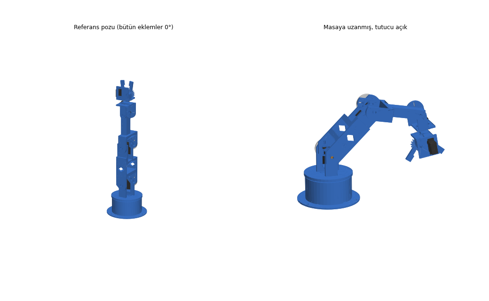
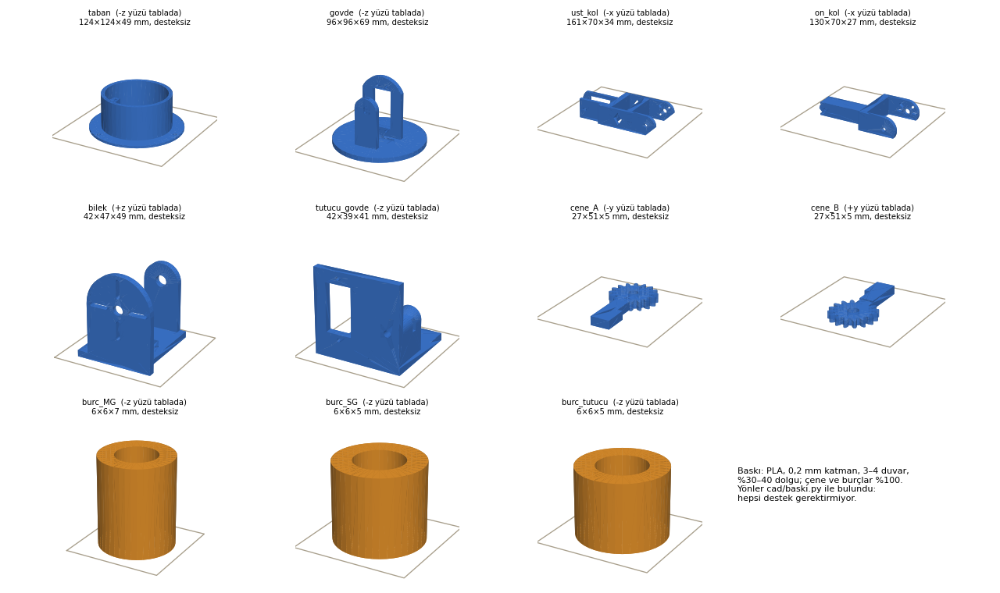

# Basılabilir parçalar (kendi tasarımımız)

How To Mechatronics'in STL'lerini satın almak yerine, kolu **bizim MG996R / SG90 ölçülerimize göre** baştan tasarladık.
Fikir HTM ve benzeri açık kaynak kollardan (5 eksen + tutucu, MG996R omuz/dirsek, SG90 bilek/tutucu, dişli çeneler);
ölçüler ve yapı bizim.



- **Simülasyon:** sayfadaki 3B kol bu parçaların kendisi ([servo-kol.html](../sim/servo-kol.html))
- **Baskı dosyaları:** [stl/](stl/) (bastırılacak), [step/](step/) (CAD; `servo_kol_montaj.step` servo zarflarıyla birlikte montaj)
- **Onshape:** [Servo Kol - basilabilir parcalar v2](https://cad.onshape.com/documents/89711f6f1d707f68bb2416e2/w/59ab7944017799fb956341a0) (özel belge, montaj sekmesi `servo_kol`). Onshape'in kendi çekirdeğiyle (Parasolid) bağımsız kontrol: üst kol / ön kol / gövde hacimleri CadQuery ile birebir aynı (88,448 / 44,915 / 50,914 cm³); "Check interference" yalnız üç SG90 horn zarfının kendi miline oturduğu yeri gösteriyor (tasarım gereği), basılacak parçalar arasında çakışma yok. Eski v1 belgesi ilk sürüm.

| Dosya | Ne yapar |
|---|---|
| [geometri.py](geometri.py) | **Tek ölçü kaynağı.** Servo ölçüleri (kaynaklı), boşluklar, kol uzunlukları |
| [parcalar.py](parcalar.py) | Parçaların CadQuery modelleri (evolvent dişli dahil) |
| [model.py](model.py) | Montaj (FK), eklem taramalı **katı çakışma kontrolü**, montaj sırasına göre **tornavida erişimi**, STEP/STL |
| [kontrol.py](kontrol.py) | Et kalınlıkları, cıvata boyları, dişli kavraması, **dayanım**, tabla sığma, tork, **devrilme**, simülasyon ölçüleriyle eşleşme |
| [mukavemet.py](mukavemet.py) | **Statik mukavemet:** CAD kütleleriyle eklem tepkileri, 19 kesit + 7 bağlantı, katman yönüne göre izin, sehim → [MUKAVEMET.md](MUKAVEMET.md) |
| [baski.py](baski.py) | **Baskı analizi:** 0,5 mm voksel, 6 yön; köprü / çıkıntı / havada başlayan bölge ayrımı, ışınla en ince duvar |
| [gorsel.py](gorsel.py) | `docs/parcalar.png` ve `docs/montaj.png` |
| [sim_mesh.py](sim_mesh.py) | Parçaları simülasyon sayfasına ağ olarak gömer (`sim/servo_mesh.js`) |
| [../onshape/onshape_yukle.py](../onshape/onshape_yukle.py) | STEP'i API ile Onshape'e yükler (anahtarlar `.env`'de). `--yeni AD` eskisine dokunmadan yeni belge açar |

```bash
pip install cadquery
python kontrol.py      # 52/52 GEÇTİ olmalı
python mukavemet.py    # HEPSİ GEÇTİ + MUKAVEMET.md
python baski.py        # 11/11 desteksiz, duvarlar ≥ 1,2 mm (~1 dk)
python model.py        # 42 tornavida yolu + 142 eklem konumunda çakışma + STEP/STL (~1,5 dk)
python sim_mesh.py     # simülasyon ağları; sonra: python ../sim/build_page.py
python gorsel.py       # belge görselleri
```

## Doğrulananlar (2026-10-23)

| Kontrol | Sonuç |
|---|---|
| Katı çakışma: J1 ±90°, J2 ±75°, J3 ±80°, J5 ±90° (J4 = 0 / 90), J4 ±90° (J5 = −90 / 0 / 90), tutucu 20–110°; 5–10° adım, servo ve horn süpürme alanı dahil | **0 çakışma.** En dar yerler: çatal ↔ yanak 2,0 mm, bilek 1,5 mm (pulla ayarlanır) |
| Tornavida erişimi: 42 vida (montaj sırasında o an takılı parçalarla) | **hepsi açık** |
| Baskı: 11 parça, destek gereği ve en ince duvar | **11/11 desteksiz**, en ince duvar 1,3 mm |
| Dişliler: m 1,5, 16 diş, 20° | her açıda 0,14 mm diş boşluğu, kavrama oranı 1,50, evolvent dışı temas yok |
| Mukavemet ([MUKAVEMET.md](MUKAVEMET.md)): 19 kesit + 7 bağlantı, servo **durma** torkunda (MG996R 13 kgf·cm, en kötü beyan), PLA katman içi 51 / katmanlar arası 17 MPa, emniyet 3 | **hepsi geçiyor.** En kritik: ön kol köprüsünün burulması, katmanlar arası, gerilme / izin %69 (kırılmaya karşı emniyet 4,3). Uç sehimi 0,27 mm; servo ölü bandı tek eklemde ~2,5 mm |
| Tork (eklem sınırları içinde en kötü poz, 50 g yük) | omuz %48, dirsek %20, bilek SG90 %57 (1,2 kgf·cm ile; 1,8 ile %38). **200 g tam uzanıkta kaldırılamaz** (omuz %97) |
| Tabla sığma (220 × 220) | hepsi; en büyüğü üst kol 161 mm. Toplam ~243 g PLA (%60 doluluk varsayımı) |
| Kinematik ölçüler simülasyonla aynı | masa → omuz 96, üst kol 120, ön kol 100, bilek → tutma noktası 95 mm; testler 8/8 |

> ⚠️ **Devrilme:** taban masaya vidalanmazsa kol uzandığında devrilir. 50 g yükle ağırlık merkezi eksenden 91 mm'ye çıkıyor, taban yarıçapı 62 mm. Ya 3 delikten masaya / bir tahtaya vidala (önerilen) ya da tabanın içine ~300 g ağırlık koy.

**Doğrulanmayanlar:** gerçek baskı toleransı ve köprü sarkması, PLA'nın sünmesi, servo ölçülerinin TAHMİN olanları (aşağıda). Yazılım kontrolü fiziksel denemenin yerini tutmaz.

## Servolar gelince, baskıdan ÖNCE ölç

`geometri.py`'de "TAHMİN" yazanlar kaynaklarda yoktu. Kumpasla ölç, değiştir, `kontrol.py`, `baski.py` ve `model.py`'yi çalıştır, sonra bastır:

| Ölçü | Şu an | Nerede kullanılıyor |
|---|---|---|
| MG996R kulak delikleri arası (uzun eksen boyunca) `DELIK_ARA` | 48,75 | gövde / üst kol / taban pilot delikleri |
| MG996R bir kulaktaki iki delik arası `DELIK_EN` | 10 | aynı |
| MG996R mil ↔ yakın gövde ucu `UC` | 10 | pencere yeri (karşı yatak oluğu ±1,5 mm'yi zaten karşılar) |
| MG996R horn dış yüzü (tabandan) `HORN_UST` ve horn göbeği çapı | 47,6 / ≤ 12 | çatal genişliği (2 mm boşluk, pulla) ve göbek havşası |
| SG90 horn dış yüzü `HORN_UST` ve göbeği | 31,5 / ≤ 9 | bilek ve tutucu |
| Kutudan çıkan horn'ların delik çapı ve yarıçapları | – | horn olukları: MG için r 9–13,5 mm, SG için r 7–15 mm |

## Parçalar ve baskı



| Parça | Adet | Boyut (mm) | Tablaya yatan yüz |
|---|---|---|---|
| taban | 1 | 124 × 124 × 49 | alt levha |
| govde | 1 | 96 × 96 × 69 | disk |
| ust_kol | 1 | 161 × 70 × 34 | yan (pahlı uçların düz tarafı, −x) |
| on_kol | 1 | 130 × 70 × 27 | yan (−x) |
| bilek | 1 | 49 × 47 × 42 | dönüş servosu levhası (ters) |
| tutucu_govde | 1 | 42 × 41 × 39 | taban levhası |
| cene_A, cene_B | 1 + 1 | 51 × 27 × 5 | düz |
| burc_MG / burc_SG / burc_tutucu | 2 / 1 / 1 | Ø6 | dik |

PLA, 0,2 mm katman, %30–40 dolgu, **üst kol ve ön kol en az 4 duvar** (köprüler burulmada kapalı kabuk gibi çalışmalı, [MUKAVEMET.md](MUKAVEMET.md)), diğerleri 3 duvar. Çeneler ve burçlar %100 dolgu. **Destek gerekmiyor.** En uzun köprü üst koldaki J3 servo penceresinin üst kenarı (~41 mm); orada servo için 0,4 mm sarkma payı bırakıldı.

## Cıvatalar (M3 seti)

| Yer | Ne | Adet |
|---|---|---|
| J2, J3 karşı yatak | M3×16 + somun + pul (burç içinden yanaktaki somun kanalına) | 2 |
| J5 karşı yatak | M3×10 + somun + pul | 1 |
| Tutucu dişli B mili | M3×16 + somun + pul | 1 |
| MG996R kulakları (J1, J2, J3) | M3×10–12, Ø2,6 pilot deliğe doğrudan (sac vida gibi) | 12 |
| SG90 kulakları | kutudan çıkan sac vidalar, Ø1,7 pilot | 6 |
| Horn bağlantıları | kutudan çıkan küçük sac vidalar (plastik horn) ya da M3 (metal disk horn) | 2–3 / eklem |
| Taban → masa | Ø4 ağaç vidası ya da işkence (3 delik, Ø4,5) | 3 |

Setteki boylar ürün sayfasında yazmıyor; geldiğinde 10 ve 16 mm olduğunu kontrol et.

## Montaj sırası (kısaca)

1. **Taban:** J1 servosunu yuvaya oturt, kulakları direklere vidala, kabloyu kablo yuvasından çıkar. Tabanı masaya / tahtaya vidala.
2. **Servoları ortala** (README §2.5), sonra J1 horn'unu gövde diskinin altına vidala, diski mile tak ve **merkez vidasını şimdi** sık (J2 servosu takılınca erişim kalmıyor).
3. **J2 servosu:** gövdedeki kulak levhasının penceresinden geçir, kulakları vidala. Üst kolun A levhasına horn'u vidala, horn'u mile tak, merkez vidasını A levhasındaki delikten sık.
4. **Karşı yatak:** somunu yanağın üstündeki kanala bırak, burcu B levhasının deliğine sok, M3×16'yı burçtan somuna vidala. Sıkmadan önce kolu birkaç kez çevir, burç mil hizasına otursun. Eksenel boşluğu (2 mm) pulla al.
5. J3 ve ön kol için 3–4'ü tekrarla. J5 (SG90) aynı mantık; somun kanalı yanağın önünde.
6. **Bilek:** dönüş servosunu bilek levhasına vidala. Tutucu gövdesini dönüş horn'una vidala, mile tak, merkez vidasını sık.
7. **Tutucu:** servoyu tutucu gövdesine vidala, B dişlisini burç + M3×16 ile göbeğe tak. Tutucu servosunu 20°'ye getir, A çenesini çapraz horn'a çeneler neredeyse kapalıyken takacak şekilde oturt. 20° = ağız ~1 mm.
8. **Kablolar:** üst servoların kablolarını kolun B levhası tarafından aşağı indirip birkaç kablo bağıyla tuttur. J1 dönerken gerilmemesi için tabanın yanında bir tur bolluk bırak.

## Tasarım kararları

- **Çatal eklem + karşı yatak:** omuz, dirsek ve bilek eğimde sürülen parça servonun iki yanını sarıyor: bir yanı horn'a, öbür yanı burç üzerinden tutucunun yanağına. Servo mili yalnız tork taşıyor, eğilme yükünü yanak alıyor.
- **Köprüler 10 mm:** eklem momenti çatal köprüsünden burulmayla geçiyor; yan yatık baskıda bu kayma katmanlar arasına düşüyor (en zayıf yön, 17 MPa). 5 mm'de ön kol köprüsünde durma torkunda emniyet ~1,3 çıkıyordu; 10 mm ile 4,3.
- **Desteksiz baskı:** üst kol ve ön kol yan yatırılarak basılıyor. Bütün elemanların tablaya bakan yüzü aynı düzlemde, yuvarlak uçların tabla tarafı 45° pahlı, hafifletme pencereleri sivri uçlu. Gövde diskte, bilek ters, tutucu tabanında; tutucunun dişli göbeği tabana inen bir sütunla taşınıyor.
- **Ölçü belirsizliğine dayanıklılık:** karşı yatak cıvatası yanakta oluklu (MG ±1,5, SG ±0,8 mm), mil yeri tahmininden bağımsız hizalanıyor. Çatal ↔ yanak 2 mm boşluk horn yüksekliği belirsizliğini pulla karşılıyor. Horn bağlantısı radyal oluklu, kutudaki farklı horn'lara ve metal diske uyuyor; iç yüzdeki havşa çıkıntılı horn göbeğini alıyor.
- **Devrilme halkası:** taban halkası gövde diskinin 2,5 mm altında; kol devrilmeye zorlanınca disk halkaya dayanır, J1 milini korur (tabanın masaya vidalanması yine şart).
- **Tutucu:** 1:1 dişli, açısal çene. Servo 20° → ağız 1 mm, 35° → 17 mm, 70° → 47 mm, 110° → 70 mm. Çene açıldıkça tutma noktası bileğe yaklaşır (35°'de 95 mm, 70°'de 87 mm). Simülasyon bu tabloyu kullanıyor.
- **Katlanma uyarısı:** J2 = ±75°, J3 = ±80°, J5 = ±90° aynı anda (kol kendi üstüne katlanınca) çene tabana değiyor. Ters kinematik masanın altına inmediği için normal kullanımda bu poza gidilmez.
